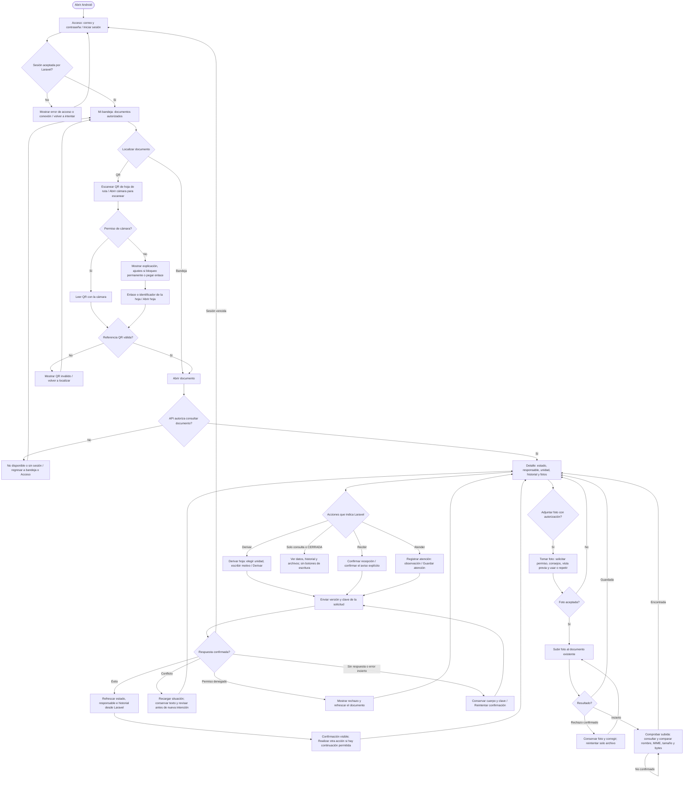

# Tarea 9 — Flujo Android actualizado, Iteración 04

Actor: recepción para registrar/derivar y funcionario de la unidad de destino para recibir/atender. Flutter presenta formularios, permisos y cámara; HTTP transporta solicitudes con token a Laravel; Laravel valida autorización y confirma datos de PostgreSQL. Android no accede directamente a la base. Se mantiene el estilo Sakai.

Este diagrama editable separa el flujo móvil del flujo web de la Tarea 9. Código de referencia: rama `feature/33-recorrido-android`, implementación móvil `2f9f6bf`, versión de entrega `eb3532153640973bfe787a32ab534602e6649c5b`, PR #40.

- Abrir por QR no envía recepción ni otro movimiento.
- Derivar mantiene la responsabilidad de origen hasta la recepción. Recibir asigna responsable y unidad; atender agrega una observación con hora del servidor.
- La atención y la foto son operaciones separadas. Una foto fallida no vuelve a guardar atención. Mientras una foto es incierta, se comprueba su existencia sin reenviarla.
- Atrás bloquea la salida durante una operación y pide confirmación si hay foto o solicitud pendiente. Una pérdida de conexión no se presenta como éxito.
- Responder y cerrar se hacen desde web; Android actualiza el mismo expediente y muestra CERRADA en consulta. No se implementan esos formularios en Android en el #33.

Implementación: `movil/lib/funciones/mi_bandeja/`, `movil/lib/funciones/qr/`, `movil/lib/funciones/recorrido/`, `movil/lib/funciones/camara/`, `movil/lib/funciones/adjuntos/` y `movil/lib/compartido/api/laravel_api.dart`.

Tras una atención, la continuación se presenta como Agregar otra atención para distinguir una nueva observación de un reintento. Los bocetos se retiraron del menú operativo.
