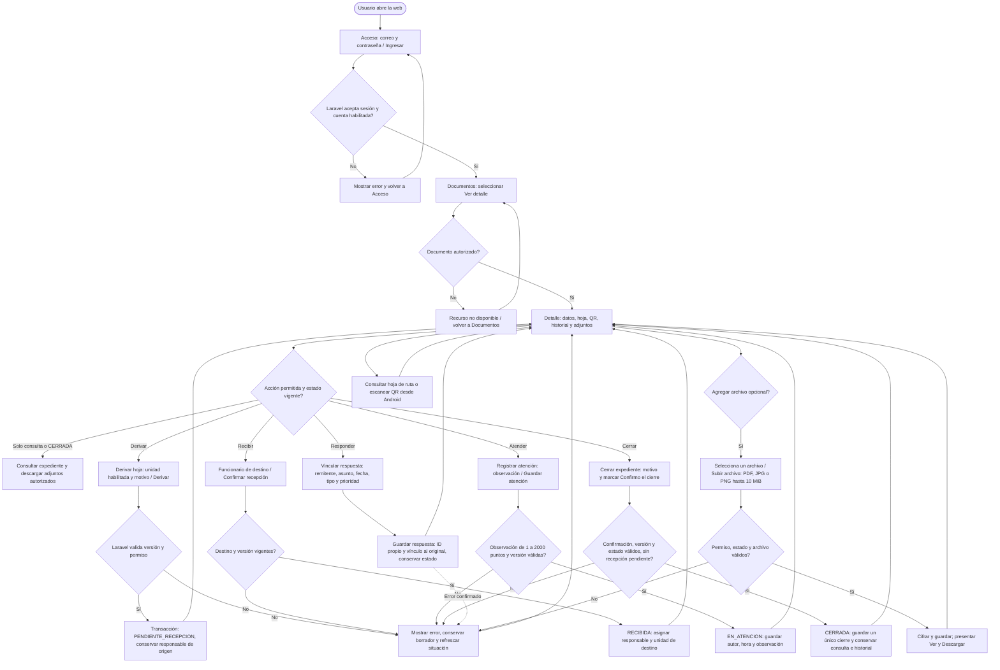

# Tarea 9 — Flujo web actualizado, Iteración 04

Actor: recepción o responsable activo; administración prepara unidades y cuentas. La web usa Sakai/Vue para presentar controles y Laravel para sesión, permisos, validación y transacciones. PostgreSQL conserva documento, hoja y movimientos. La foto se guarda cifrada en almacenamiento privado; PostgreSQL guarda su referencia. Respuesta y cierre se operan desde web.

Este diagrama editable actualiza el recorrido previsto del documento de Tarea 9 del 04/11/2026. No modifica ni sustituye silenciosamente ese PDF. Código web de referencia: PR #39, `feb6011`, más las confirmaciones del PR #40, `eb35321`.

- El QR es una lectura: no recibe ni modifica el expediente.
- Cada escritura de recorrido envía versión y clave de solicitud; un reintento conserva la misma intención y recupera su resultado. Un conflicto exige refrescar antes de una nueva intención.
- Si se pierde una respuesta, no se asume éxito: consultar el detalle y recuperar el resultado de la misma solicitud. No generar otro registro por una respuesta incierta.
- El alta inicial está en Nueva correspondencia: datos obligatorios, validación Laravel y guardado atómico de documento y hoja. Los errores retornan al formulario; un reintento del mismo alta usa su misma clave.
- No se ofrecen destinos si no hay otra unidad habilitada. El detalle solo presenta acciones autorizadas; el servidor vuelve a validarlas.

Implementación: `web/resources/views/documents/show.blade.php`, `web/resources/js/sakai/DocumentDetail.vue`, `web/resources/js/sakai/SakaiForm.vue`, `web/app/Services/RouteSheetWorkflow.php` y `web/routes/web.php`.

Las confirmaciones del servidor aparecen como aviso visible de éxito. Al consultar una hoja CERRADA se conserva además el mensaje Expediente cerrado, incluso después de volver a abrirla. Vincular una respuesta conserva el estado de la hoja; cerrar es una acción explícita diferente.
