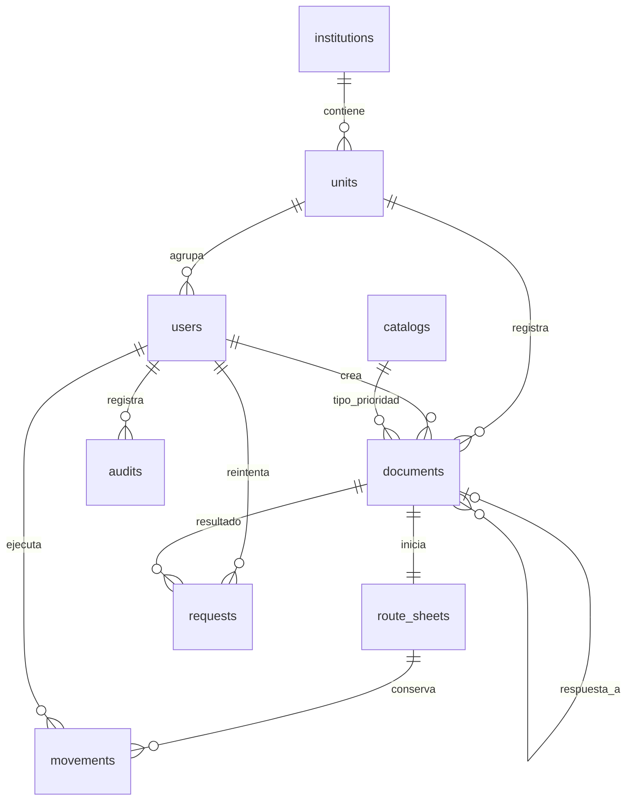

# Modelo de datos y recorrido

Referencias: #4, #11; documentación del sistema, páginas 3, 15, 18 y 22. Modelo del núcleo Laravel revisado y aprobado en PR #12. La aceptación del diseño completo #4, incluidas operaciones futuras, sigue siendo independiente.

| Entidad | Identificación y reglas |
| --- | --- |
| institutions | Código único; una institución configurada por instalación |
| units | Código y nombre únicos por institución; habilitada sin eliminación |
| users | Correo único, hash, unidad, rol, habilitado y versión de autorización |
| catalogs | Código y nombre únicos por clase (`tipo` o `prioridad`); habilitación conservando referencias |
| documents | UUID, código y guía únicos; remitente, asunto, fecha, tipo, prioridad, unidad, creador y vínculo opcional de respuesta |
| route_sheets | UUID y código propios; documento único; responsable activo, destino pendiente opcional, estado y versión |
| movements | UUID, hoja, actor, acción, estado resultante, origen/destino y fecha UTC del servidor |
| requests | Clave única por actor y operación, huella de datos y documento resultante |
| audits | Actor, acción, recurso y fecha; no contiene contraseñas o tokens |

## Invariantes implementadas en semana 2

La operación de registro toma un bloqueo de fila del actor en PostgreSQL, reconoce la clave y valida catálogos/unidad bajo transacción. Crea documento, hoja, evento REGISTRO en REGISTRADA, solicitud y auditoría. El ID del documento y el de la hoja son distintos; no hay operaciones públicas para cambiarlos. Los códigos usan ULID para evitar secuencias basadas en contar filas. Las claves foráneas restringen eliminaciones de referencias.

Un reintento con la misma clave y datos devuelve el resultado original; otra carga devuelve 409. Los registros iniciales son visibles por unidad (o para administrador). El responsable inicial es el actor. La derivación posterior es otro incremento.

## Diseño futuro, todavía no implementado

Archivo pertenecerá a documento con MIME real, tamaño, ubicación privada y versión de clave. El QR tendrá una referencia opaca. Las siguientes transiciones requieren permiso, versión e idempotencia: REGISTRADA → PENDIENTE_RECEPCION → RECIBIDA → EN_ATENCION; RECIBIDA/EN_ATENCION permiten derivar o cerrar. Recepción sustituye responsable y elimina destino pendiente en una transacción; escanear no recibe.

Una respuesta será otro documento con response_to_id; correcciones del historial serán eventos nuevos. Archivos/QR se prevén para semana 3 y recorrido para semana 4. El esquema actual prepara algunos campos, pero no acredita esas funciones.
