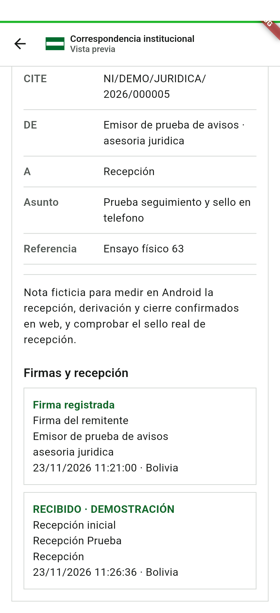
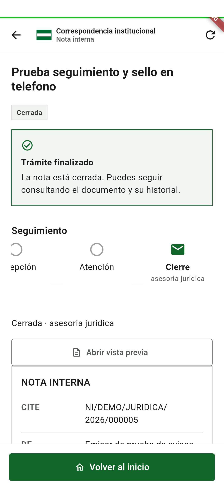

# Manual de uso de Correspondencia en Android

Esta aplicación permite revisar, firmar y recibir notas de su institución desde el teléfono. Cada persona ve las notas que le corresponde consultar o atender.

## Entrar a la aplicación

1. Abra **Correspondencia** en el teléfono.
2. Escriba su correo completo y su contraseña.
3. Pulse **Iniciar sesión**.
4. Si el teléfono solicita permiso para enviar notificaciones, pulse **Permitir**.

Al entrar aparecerá **Inicio**. Necesita una cuenta habilitada por su institución y conexión a la red indicada por el responsable del sistema.

## Encontrar sus notas

1. En Inicio, pulse **Notas internas**.
2. Seleccione la bandeja que corresponde a su tarea. Deslice las pestañas hacia los lados si no ve todas las opciones.
3. Pulse el asunto de la nota que desea abrir.

- **Por firmar:** notas que usted preparó y debe firmar antes de enviarlas.
- **Por revisar:** notas que necesitan su aprobación antes de continuar.
- **Por recibir:** notas enviadas a su oficina cuya recepción debe confirmar.
- **Por atender:** notas recibidas que necesitan una respuesta o una actuación.
- **Copias:** notas compartidas con usted para su conocimiento.

Una bandeja vacía significa que no tiene notas disponibles allí. Las acciones aparecen según su función y la etapa de cada nota.

## Firmar una nota que usted preparó

El remitente es la persona que envía la nota. La preparación y el envío se hacen en la web; la firma se realiza en el teléfono.

1. Prepare la nota en la web y seleccione **Enviar a firma**.
2. En el teléfono, entre con la misma cuenta y abra **Notas internas**.
3. Seleccione **Por firmar** y abra esa nota.
4. Pulse **Abrir vista previa** y lea el documento. Después vuelva a la nota.
5. Pulse **Firmar borrador**.
6. Dibuje su firma con el dedo dentro del espacio indicado. Si necesita repetirla, utilice el botón para borrar el trazo.
7. Confirme la firma y espere el resultado.

La nota quedará firmada. Vuelva a la web para emitirla. Si después modifica el contenido, deberá revisar y firmar otra vez antes de enviarla.

## Revisar y dar conformidad

Una autoridad VÍA es una persona que debe revisar la nota antes de que llegue al destinatario. Dar conformidad significa aprobar que continúe su recorrido.

1. Abra **Notas internas** y seleccione **Por revisar**.
2. Abra la nota y lea su contenido en **Abrir vista previa**.
3. Vuelva a la nota y pulse **Firmar y dar conformidad**.
4. Dibuje su firma y confirme.
5. Espere a que aparezca el resultado.

La nota avanzará al siguiente paso y dejará de estar pendiente de su revisión. Si deben revisarla dos personas, la segunda actúa después de la primera.

## Confirmar que su oficina recibió una nota

1. Abra **Notas internas** y seleccione **Por recibir**.
2. Abra la nota y compruebe que corresponde a su oficina.
3. Lea el documento y pulse **Confirmar recepción**.
4. Confirme la acción cuando se lo solicite la pantalla.
5. Espere el resultado y abra **Abrir vista previa**.

La recepción quedará registrada. El sello mostrará la oficina, la persona que recibió y la fecha y hora. La nota podrá continuar a su atención.

## Atender una nota

1. Seleccione **Por atender** y abra la nota.
2. Lea el documento y pulse **Ver expediente y adjuntos** para consultar sus archivos y las acciones disponibles.
3. Para dejar constancia de una actuación, seleccione **Registrar atención**, complete la información solicitada y confirme.
4. Si debe enviarla a otra oficina, seleccione **Derivar hoja**, elija el destino, indique el motivo y confirme.

La nueva actuación aparecerá en el historial. Si la deriva, la oficina de destino deberá confirmar que la recibió. Algunas acciones pueden estar disponibles solo en la web o para la persona responsable de la nota.

## Ver por dónde va la nota

1. Abra la nota que desea consultar.
2. Observe la barra de seguimiento sobre el documento.
3. Lea la etapa y la oficina indicadas por el sobre.
4. Mantenga abierta la pantalla para ver los cambios mientras continúa el trámite.

Las etapas son **Preparación**, **Revisión**, **Recepción**, **Atención** y **Cierre**. El seguimiento cambia automáticamente cuando se confirma una acción. Si pierde la conexión, el último estado visible puede estar desactualizado.

## Consultar el documento y sus archivos

Pulse **Abrir vista previa** para leer la nota y consultar las constancias de firma y recepción. Pulse **Ver expediente y adjuntos** para consultar el historial y abrir los archivos que tenga permiso para ver.

En la bandeja puede usar **Buscar por CITE o asunto**. El CITE es la referencia con la que la institución identifica una nota. La búsqueda se realiza sobre las notas cargadas de la bandeja seleccionada.

También puede pulsar **Escanear QR de hoja de ruta**, permitir el acceso a la cámara y apuntar al QR del documento. Se abrirá la consulta si su cuenta tiene permiso. Un QR no permite acceder a notas de otras personas sin autorización.

## Abrir un aviso

1. Cuando llegue una notificación de Correspondencia, tóquela.
2. Si se solicita, inicie sesión con su cuenta.
3. Lea la nota que se abrió y realice únicamente la acción que le corresponda.

Abrir un aviso no firma ni confirma la recepción. El teléfono debe estar encendido y conectado a Internet; la pantalla puede estar apagada. Si no encuentra la notificación, consulte **Avisos** dentro de la aplicación.

## Reconocer que terminó el trámite

El responsable registra el cierre cuando corresponde. Al confirmarse, la nota muestra **Trámite finalizado** y el seguimiento llega a **Cierre**. Podrá seguir consultando el documento y su historial.

Pulse **Volver al inicio** para continuar con otra tarea sin cerrar su sesión.

## Salir de su cuenta

Abra el menú de la aplicación y pulse **Cerrar sesión**. Antes de prestar el teléfono a otra persona, compruebe que aparece la pantalla para iniciar sesión.

## Si algo no sale como esperaba

- **No puede entrar:** revise el correo y la contraseña. Si el problema continúa, comuníquese con el responsable de las cuentas de su institución.
- **No encuentra una nota:** revise la bandeja y la cuenta con la que entró.
- **No puede conectar:** compruebe la red del teléfono y consulte si el sistema está disponible.
- **Una acción sigue pendiente:** no la dé por terminada. Use el reintento que ofrece la aplicación y espere su confirmación.
- **No llegan avisos:** compruebe la conexión y el permiso de notificaciones del teléfono. Abra Correspondencia si la había detenido desde los ajustes.
