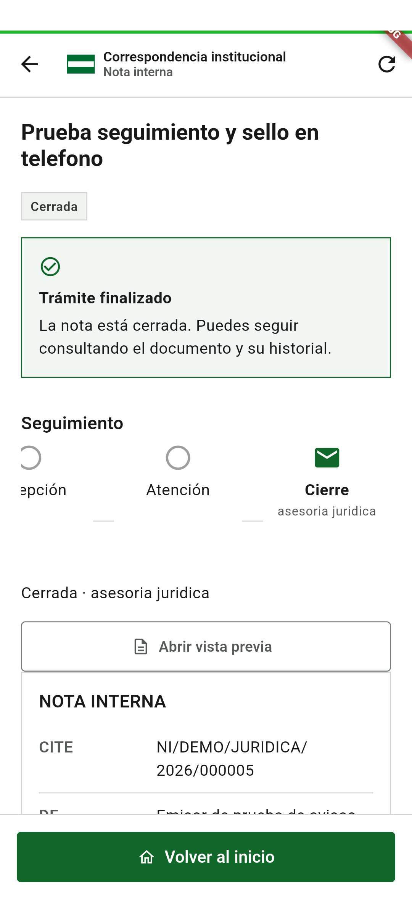
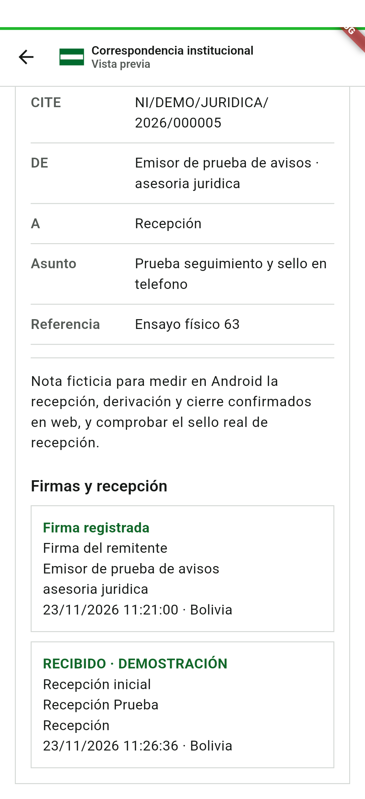

# #63 · Integración del sello y seguimiento

23/11/2026, hora de Bolivia. Base: `a165362` (`develop` con #72 integrado).

## Comprobado

- Adaptación Android al `sello_recepcion` real de #72, sin mostrar su ID interno.
- Constancias de firma desde el detalle autorizado: versión válida del remitente
  y conformidades VÍA ya confirmadas. No se publican trazos ni claves de reintento.
- El QR de una hoja añade el vínculo a la nota solo para una cuenta autorizada.
- Suite Flutter completa en serie: 206 pruebas aprobadas y cuatro pruebas
  optativas omitidas. También pasaron 59 pruebas focalizadas y el analizador. Incluyen
  actualización automática, permiso retirado, desconexión, vista previa, sello,
  QR, retorno al inicio y las regresiones de notificaciones de #71.
- 110 pruebas Laravel aprobadas; después se repitieron las nueve del flujo con
  335 aserciones para comprobar firmas antiguas, pendientes y metadatos vigentes.
- APK arm64 debug compilado, `versionCode` 2001. SHA-256:
  `3a486a7523689b0405670612d49167ebc581f063e14f91d0e28ee88f6cb26106`.

La primera ejecución concurrente falló por conexión en la prueba histórica de
Node. Ese caso pasó aislado y en la ejecución completa en serie.

## Recorrido contra el servidor real

Se creó una nota ficticia por el formulario HTTP web con sesión y CSRF. La firma
preparatoria usó trazos ficticios por la API. La emisión, primera recepción,
derivación, segunda recepción, atención y cierre se ejecutaron por formularios
HTTP web. No se presentan como interacción manual con un navegador.

Laravel/PostgreSQL y Camunda fueron reales. Después de cada transición se
comparó el seguimiento de la ruta web con el detalle API que consume Android.
El resultado final fue `cerrada`/`cierre` y Camunda `COMPLETED`. El sello apareció
renderizado en web y en la API, permaneció idéntico después de derivar y cerrar,
y repetir la primera recepción con su clave y versión originales devolvió el
mismo sello. Se conservaron cinco movimientos de hoja.

Se comprobó el recurso QR autorizado y que la hoja resuelve la misma nota.
[Resultados del servidor](resultado-servidor.json).

Los tiempos `tiempo_http_ms` miden el formulario y las lecturas HTTP de ese ensayo.
**No son la latencia de la barra en el teléfono** y no acreditan el objetivo móvil
de hasta cinco segundos. El backend utilizado fue la instalación local Wi-Fi;
esta ejecución no acredita el servidor Ubuntu final de #65.

## Prueba física aprobada · #63

Se ejecutó `seguimiento_sello_real_test.dart` en un POCO F3 con Android 13,
Laravel/PostgreSQL y Camunda reales. La nota fue emitida desde el formulario HTTP
web. El teléfono mantuvo el mismo detalle abierto mientras se confirmaron las
acciones mediante formularios web con sesiones independientes y CSRF.

Desde la respuesta HTTP de la acción confirmada hasta observar la etiqueta,
unidad y sobre correctos en los widgets reales de Android se midió:

- Primera recepción: **1193 ms**.
- Derivación: **1542 ms**.
- Recepción en la unidad derivada: **1669 ms**.
- Atención: **1336 ms**.
- Cierre: **1359 ms**.

Todos los cambios quedaron por debajo de cinco segundos sin tocar Actualizar ni
reabrir el detalle. Se comprobó el sello real, su receptor y unidad, la ausencia
de su ID en la pantalla y la resolución del QR hacia la misma nota. Al cierre se
mostró **Trámite finalizado**. El sello no cambió y Camunda quedó `COMPLETED`, con
cinco movimientos de hoja.

El ensayo es automatizado sobre la app real en el teléfono; los formularios HTTP
no se presentan como clics manuales en un navegador. El QR se comprobó mediante
su resolución autorizada y pruebas de la apertura en Android; no se acredita un
escaneo físico con cámara en esta ejecución.

[Resultado del teléfono](resultado-telefono.json). La API circuló por Wi-Fi,
sin `adb reverse`. El USB se utilizó para instalar y controlar el ensayo.
Al terminar se reinstaló y abrió el APK normal, conservando los datos y sin las
constantes privadas de la compilación de integración. El SHA-256 del APK normal
se conserva arriba. La validación contra el servidor Ubuntu desplegado sigue
correspondiendo a #65.

El cambio queda listo para la revisión cruzada de Mathew. #63 se cerrará al
fusionar su PR aprobado.

## Capturas del teléfono

La comprobación de lectura de la nota cerrada pasó también en el teléfono y
confirmó el sello dentro de la vista previa. Estas imágenes provienen de esa
ejecución real con datos ficticios.

